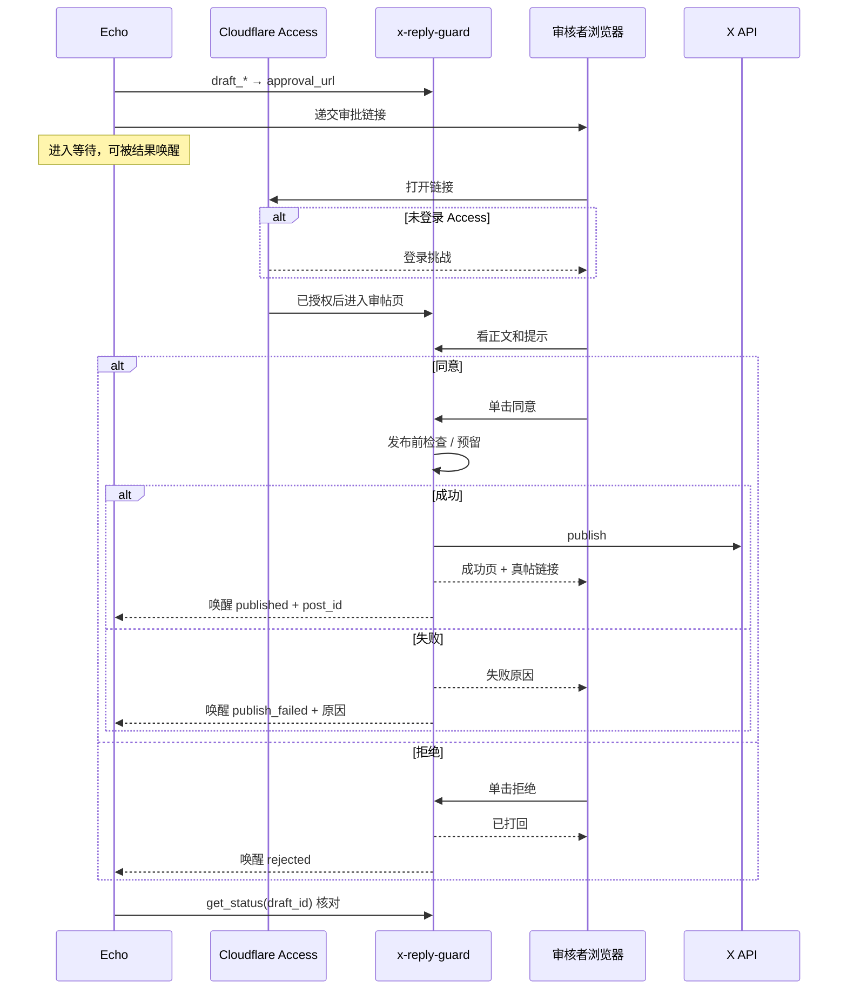

# x-reply-guard-mcp：单击审核即发布，Echo 即时接手

> 版本：2026-11-05 · 状态：已批准（大毛，2026-11-05） · 作者：Blueprint

## 变更记录
- 2026-11-05：按群里定稿的用户故事重写；取代已暂停的 `2026-11-05-approve-then-publish.md`（该稿含擅自加入的密码闸，作废）
- 2026-11-05：安全改为 Cloudflare Access 护住审帖页——审核者无感（已登录 Access 则单击即同意/拒绝），外人即使有链接也无法操作

## 1. 问题、目标、成功指标
**问题**：现行流程把「人审」和「发出」拆开——人在浏览器点同意后，还要 Echo 再调 `publish`；Echo 也不能在审完当下自动继续。人多一步，机器人又不得不当发射按钮。若去掉审帖密码又只靠链接，则持链者可任意发帖，不安全。

**目标**：审核者已处于 Cloudflare Access 登录态时，单击同意即发出并能打开真帖，单击拒绝即打回重写（无密码、无二次确认）；未通过 Access 者即使持有链接也不能审、不能发。Echo 审完马上自己醒，已发收尾、打回重写。

**成功指标**：大毛日常点同意/拒绝不必再输审帖密码；未授权访客打不开可用的审帖操作；真帖走通「起草 → 打开链接 → 同意 → 看见真帖」；Echo 无需再 @ 就会收尾或重写。

## 2. 用户和场景
- **审核者（大毛）**：Echo 把审批链接递过来；浏览器若尚未过 Access 则先完成 Access（一次性会话）；之后看最终正文和提示，点同意或拒绝。
- **起草者（Echo）**：调用 `draft_*` 拿到链接交给审核者；等待审核结束；根据结果收尾或重写。
- **外人**：即使拿到审批链接，也不能完成同意或拒绝。

## 3. 范围
**做**
- 审帖相关路径（查看、同意、拒绝及结果页）置于 **Cloudflare Access** 之后；仅 Access 允许的身份可操作。
- 审批页：同意 = 服务端立即按现有发布规则发出该草稿；成功页可打开真帖；失败页展示原因。
- 审批页：拒绝 = 打回；草稿进入可被 Echo 识别的拒绝态。
- 在已通过 Access 的前提下，同意 / 拒绝 **均不** 再要求 `AUTH_PASSWORD`，也 **不** 要求二次确认。
- 审核结果（已发成功 / 拒绝 / 发出失败）必须能让 Echo **马上醒过来** 并知道 `draft_id` 与结果（含成功时的 `post_id` 或失败原因摘要）。
- `get_status` 支持按 `draft_id` 查询，供 Echo 核对。
- `approval` 模式下，浏览器同意是唯一正常发布入口；MCP `publish` 不再作为默认发射路径（默认：已发成功则幂等返回已存 `post_id`，否则提示走审批页）。
- 更新 README / 工具英文描述与 Access 部署说明；GitHub 文案英文。

**不做**
- 不在审批页提供正文编辑（打回后由 Echo 重写新草稿）。
- 不改 `auto` 模式（仍由 MCP `publish` 发出）。
- 不改 OAuth 登录同意页（`/authorize`）的既有密码；本需求护的是**审帖页**。
- 不扩 hidden 字符等新风控规则。
- 不在本 PRD 里改 Echo 人设全文；Echo 侧唤醒后的重写/收尾另开对接。

## 4. 用户故事和验收标准

### S0 Access 挡住外人，登录后对你无感
作为审核者，我希望安全由 Access 保证，我自己已登录时点同意/拒绝不必再输审帖密码。

- **Given** 访客未通过 Cloudflare Access  
  **When** 打开或提交任意审帖链接（含合法 `sig`）  
  **Then** 无法看到可操作的同意/拒绝，也无法触发发布（表现为 Access 拦截或等价未授权，且服务端不执行同意/拒绝业务）。

- **Given** 审核者已通过 Access（会话有效）  
  **When** 打开合法审批链接  
  **Then** 直接看到正文和提示以及同意/拒绝，**不**再出现审帖 `AUTH_PASSWORD` 输入框。

### S1 审核者同意即发并可打开真帖
作为审核者，我希望在浏览器看正文和提示后单击同意就直接发帖，并能查看实际发布的帖子。

- **Given** 已通过 Access，`PUBLISH_MODE=approval`，草稿 `pending`，且发送前检查可通过  
  **When** 单击同意（无密码、无二次确认）  
  **Then** 服务端发出该草稿；页面展示成功，并提供可打开的真帖链接（`https://x.com/<X_USERNAME>/status/<post_id>`）；可按该 `draft_id` 读到已发与同一 `post_id`。

- **Given** 已通过 Access，但发送前检查失败或 X 发出失败  
  **When** 单击同意  
  **Then** 页面展示失败原因；不出现「已发出」成功态；Echo 收到失败类结果。

### S2 审核者拒绝即打回重写
作为审核者，我希望单击拒绝就把稿子打回，让 Echo 重写。

- **Given** 已通过 Access，草稿 `pending`  
  **When** 单击拒绝（无密码）  
  **Then** 草稿进入拒绝态；不调用 X 发布；Echo 马上得知该 `draft_id` 被打回。

### S3 Echo 审完马上醒
作为 Echo，我希望审核一结束就马上自己醒过来：已发则收尾，打回则重写再提审。

- **Given** Echo 已提交草稿并进入等待  
  **When** 审核者同意且发出成功，或拒绝，或同意但发出失败  
  **Then** Echo 在无人再 @ 的情况下被唤醒，载荷至少含 `draft_id`、结果类型（published / rejected / publish_failed）、成功时的 `post_id`、失败时的原因摘要；随后可 `get_status(draft_id)` 核对。

### S4 按 draft_id 核对
作为 Echo，我希望随时能按 `draft_id` 查到审核/发布状态，以便醒来后核对。

- **Given** 某 `draft_id` 仍存在于服务端  
  **When** 调用 `get_status` 并传入该 `draft_id`  
  **Then** 返回可区分 pending / rejected / published（含 `post_id`）/ publish_failed（或等价 used 无 post_id）等状态；**不**返回草稿明文正文。

- **Given** 不传 `draft_id`  
  **When** 调用 `get_status`  
  **Then** 现有汇总行为保持可用。

## 5. 流程

产品约束（实现归 Forge，结果必须满足）：
- 同意路径复用与现网 `publish` 相同的检查、预留、去重、配额、不回滚规则。
- 「马上醒」= 状态变更主动通知到已配置的 Echo 唤醒入口。
- 审帖页安全以 Cloudflare Access 为准；链接仍带现有 HMAC 签名与过期；页面保留 CSRF / Origin 防护。应用层不再校验审帖 `AUTH_PASSWORD`。
- Access 策略（允许哪些身份）由大毛在 Cloudflare 控制台配置；仓库提供路径保护说明与本地/e2e 的测试替身约定。

## 6. 非功能要求
- **无感**：Access 会话有效时，同意/拒绝单击即生效，无审帖密码、无二次确认。
- **安全**：无有效 Access 会话则不能完成同意/拒绝/发布；唤醒通知不得含草稿正文或密钥。
- 英文文案进 GitHub；本 PRD 中文。

## 7. 待定问题
| # | 问题 | 当前默认 | 需要谁定 |
|---|------|---------|---------|
| 1 | 同意后发送前检查失败，草稿状态 | 可再次打开链接重试同意（未占用）；不要求重新 draft | 大毛若不同意再说 |
| 2 | 预留后 X 失败 | 与现网一致不回滚；publish_failed；需新草稿再发同文 | 现网安全默认 |
| 3 | Echo 唤醒入口 URL / 鉴权 | 部署时配置；PR 内留配置项与测伪端点 | Forge 部署时跟大毛要值 |
| 4 | Access 允许的具体 IdP / 邮箱 | 大毛在 CF 控制台自配；文档只写「保护 `/admin/approve/*`」 | 大毛部署时 |

## 8. 决策日志
| 日期 | 决策 | 理由 |
|------|------|------|
| 2026-11-05 | 同意 = 直接发帖；拒绝 = 打回重写 | 大毛口述审核者故事 |
| 2026-11-05 | 不要审帖密码、不要二次确认 | 大毛要无感；否定密码为故事一部分 |
| 2026-11-05 | 用 Cloudflare Access 保证安全 | 大毛要「无感且安全」；选定 CF Access |
| 2026-11-05 | 拒绝同样必须过 Access | Blueprint 默认，防持链者乱打回 |
| 2026-11-05 | Echo 审完马上自己醒 | 大毛确认 |
| 2026-11-05 | 打回不在页内编辑 | Blueprint 默认 |

## 9. 里程碑
| # | 内容 | 覆盖故事 | PR |
|---|------|---------|----|
| M1 | Access 护审帖路径（含文档与测试替身）；去审帖密码；同意即发布；成功/失败/拒绝页；存 `post_id`；`get_status(draft_id)`；状态变更唤醒通知；approval 下调整 `publish`；英文 README；单测与 e2e | S0–S4 | 一个 PR（本仓库） |
| M2 | Echo 接入唤醒后自动收尾或重写提审 | S3 | Echo 侧任务；Guard M1 合并后另开 |

验收：M1 仓库测试 + 大毛真机（已登录 Access 单击同意/拒绝；无 Access 无法操作）；M2 Echo 真帖闭环。
